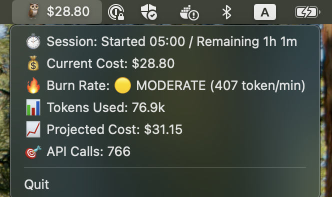

# CCOwl 🦉

A cross-platform status bar application that monitors Claude Code usage in real-time. Supports macOS and Ubuntu/Linux.

## Features



- **Real-time monitoring**: Displays current Claude Code session costs in your status bar
- **Detailed information**: Click to view comprehensive usage statistics
- **Live updates**: Automatically refreshes every 5 seconds
- **Human-friendly display**: Shows costs, burn rates, and projections in an easy-to-understand format

## Installation

### Download from Releases

Download the latest release for your platform from the [releases page](https://github.com/sivchari/ccowl/releases).

### Build from Source

```bash
git clone https://github.com/sivchari/ccowl.git
cd ccowl
go build -o ccowl
./ccowl
```

## Requirements

- macOS or Ubuntu/Linux
- [Claude Code CLI](https://docs.anthropic.com/en/docs/claude-code) installed and configured
- The `ccusage` command must be available in your PATH

### Ubuntu/Linux Additional Requirements

For Ubuntu/Linux systems, install the required dependencies:

```bash
sudo apt update
sudo apt install -y libayatana-appindicator3-dev pkg-config
```

## Usage

1. Make sure Claude Code CLI is installed and `ccusage` command is working
2. Run CCOwl:
   ```bash
   ./ccowl
   ```
3. The app will appear in your status bar as 🦉 with the current session cost
   - macOS: Status bar in the top menu
   - Ubuntu/Linux: App Indicator in the Gnome top bar
4. Click on the status bar icon to see detailed information:
   - Session timing and remaining time
   - Current cost and burn rate with status indicators
   - Token usage statistics
   - Projected final costs
   - API call counts

## Running as a Background Service

### macOS (Launch Agent)

To run CCOwl automatically at login without a terminal window:

1. Create a Launch Agent plist file at `~/Library/LaunchAgents/com.ccowl.plist`:

```xml
<?xml version="1.0" encoding="UTF-8"?>
<!DOCTYPE plist PUBLIC "-//Apple//DTD PLIST 1.0//EN" "http://www.apple.com/DTDs/PropertyList-1.0.dtd">
<plist version="1.0">
<dict>
    <key>Label</key>
    <string>com.ccowl</string>
    <key>ProgramArguments</key>
    <array>
        <string>/path/to/ccowl</string>
    </array>
    <key>EnvironmentVariables</key>
    <dict>
        <key>PATH</key>
        <string>/opt/homebrew/bin:/usr/local/bin:/usr/bin:/bin</string>
    </dict>
    <key>RunAtLoad</key>
    <true/>
    <key>KeepAlive</key>
    <true/>
    <key>StandardOutPath</key>
    <string>/tmp/ccowl.log</string>
    <key>StandardErrorPath</key>
    <string>/tmp/ccowl.err</string>
</dict>
</plist>
```

2. Replace `/path/to/ccowl` with the actual path to your ccowl binary.

3. Load the Launch Agent:
```bash
launchctl load ~/Library/LaunchAgents/com.ccowl.plist
```

4. To stop the service:
```bash
launchctl unload ~/Library/LaunchAgents/com.ccowl.plist
```

### Ubuntu/Linux (systemd)

Create a systemd user service at `~/.config/systemd/user/ccowl.service`:

```ini
[Unit]
Description=CCOwl - Claude Code Usage Monitor

[Service]
ExecStart=/path/to/ccowl
Restart=always

[Install]
WantedBy=default.target
```

Then enable and start:
```bash
systemctl --user enable ccowl
systemctl --user start ccowl
```

## Status Indicators

- 🟢 **LOW**: < 300 tokens/min
- 🟡 **MODERATE**: 300-700 tokens/min  
- 🔴 **HIGH**: > 700 tokens/min

## Development

### Running Tests

```bash
go test ./...
```

### Running Lint

```bash
go vet ./...
```

## License

MIT License - see [LICENSE](LICENSE) file for details.

## Contributing

Pull requests are welcome! Please make sure tests pass before submitting.
